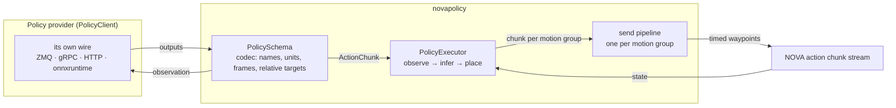
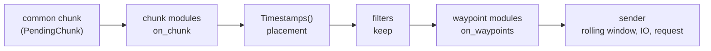
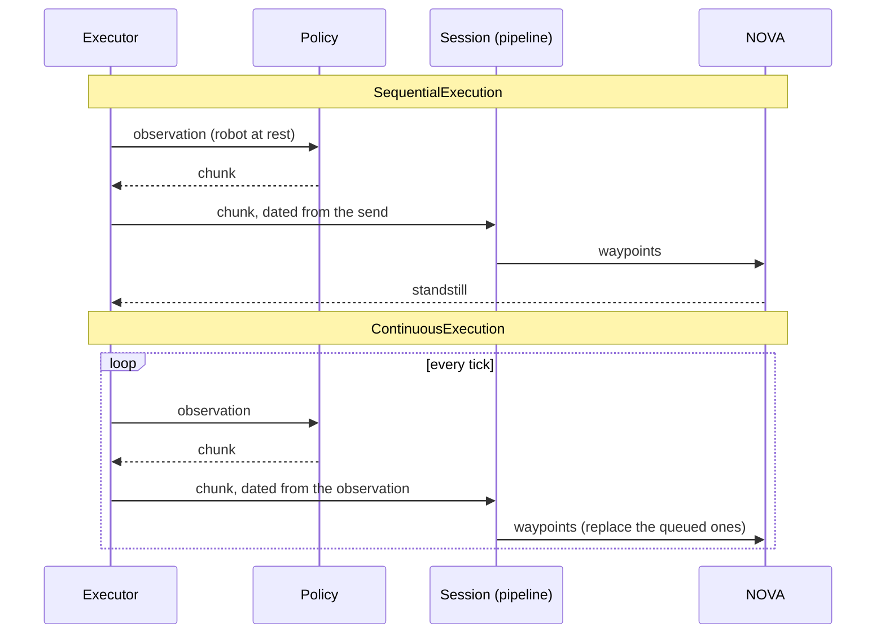

# Architecture

novapolicy runs a trained policy on NOVA robots. It does two things: **mapping** (robot state,
IO and images into the policy's names and units, and the policy's answer back into NOVA joint or
TCP targets) and **transport** (placing those targets on NOVA's clock and streaming them as
action chunks). NOVA owns the motion: profiles, interpolation, limits, IK
([ADR 0001](adr/0001-map-and-transport.md)). Everything that works around a limitation of the
action chunk streaming interface is a module you can switch on or off.



## The send pipeline

Every chunk a policy, a jogger or a replay produces passes one ordered list of modules per motion
group, a pipes-and-filters chain over one message type, the `PendingChunk`
([ADR 0009](adr/0009-opt-in-pre-send-modules.md), [ADR 0010](adr/0010-built-ins-are-modules.md)):



| Kind | Sees | May change | Built-ins |
| --- | --- | --- | --- |
| chunk module | every chunk, when queued | steps and timing | `Smoothing`, `TimestepTimeline`, `Bridge`, `EndpointRamp`, `JointClamp`, `ServoHorizon`, `HoldPadding` |
| `Timestamps()` | the chunk | each step's time (contracts T1, T2, T4) | placement; `grid_ms` puts one-step joint targets on NOVA's cycle grid |
| filter | the timed waypoints | which go out, never their time | `DropLate` |
| waypoint module | the timed waypoints, at every send | values only | `EaseIn` |

How to use it — the defaults per use, every module's parameters, adding, removing and writing
modules, and what the list check refuses — is the customer guide
[docs/pipeline.md](../docs/pipeline.md). This page keeps why the modules work the way they do.

### The defaults

The default lists (`novapolicy/pipeline/defaults.py`), with the opt-in modules of the joggers:

```mermaid
flowchart TB
    subgraph seq["SequentialExecution"]
        direction LR
        s1[Bridge] --> s2[EndpointRamp] --> s3[JointClamp] --> s4[HoldPadding] --> s5[Timestamps] --> s6[DropLate]
    end
    subgraph cont["ContinuousExecution with a timestep queue"]
        direction LR
        c0[Smoothing] --> c1[TimestepTimeline] --> c2["Bridge(always_anchor)"] --> c3[JointClamp] --> c4[HoldPadding] --> c5[Timestamps] --> c6[DropLate]
    end
    subgraph jog["jog_joints / jog_tcp, with the opt-in modules"]
        direction LR
        j0["ServoHorizon (opt-in)"] --> j1[HoldPadding] --> j2[Timestamps] --> j3[DropLate] --> j4["EaseIn (opt-in)"]
    end
```



| Module | Works around | Off by |
| --- | --- | --- |
| `Bridge` | a policy's first step far from the robot would be a jump | leaving it out |
| `EndpointRamp` | each sequential chunk starts and ends at rest | leaving it out |
| `JointClamp` | an out-of-range target pauses the motion | leaving it out |
| `HoldPadding` | a short chunk ends without a braking horizon; in sequential execution, an arm still moving at the last step brakes past it (held 300 ms after it) | leaving it out (use `delay_until_braking_ms`) |
| `DropLate` | a waypoint already due makes the controller jump back | leaving it out |
| `Smoothing` | blending overlapping plans leaves kinks | leaving it out |
| `TimestepTimeline` | a queue's replacements must continue its timeline | (required for a queue) |
| `EaseIn` | a time-based target with velocity at t=0 lunges from rest | not adding it |
| `ServoHorizon` | a lone live target makes the follower overshoot a sudden stop; a spring-damper sends a reachable, braking horizon instead ([ADR 0022](adr/0022-servo-horizon-for-live-targets.md)) | not adding it |
| `Timestamps(grid_ms=32)` | NOVA's follower pulses around a one-step policy's pace when a waypoint falls just after its 8 ms cycle ([ADR 0021](adr/0021-one-step-targets-on-the-cycle-grid.md)) | `Timestamps()` (the default) |

Why each one works the way it does: `HoldPadding` gives a short chunk a horizon the controller can brake within; it skips one-step
chunks placed ahead, which the next step replaces before they are due and which a hold would make
the controller brake towards, and it ends a chunk in a hold, which leaves
`delay_until_braking_ms` no velocity to keep. `JointClamp`: see [ADR 0015](adr/0015-clamp-joint-targets.md). `EndpointRamp` adds
points at the chunk's own spacing, so the robot gets real time to accelerate and brake.
`Smoothing` with two passes removes the waypoint-scale kinks where a queue blends overlapping
predictions, at the cost of rounding intended corners by about two steps; it goes first because
the bridge has to end on the smoothed first step. `Bridge` starts with a hold on the measured
position, so sending the request does not use up the first interval; `always_anchor` gives a
continuously refreshed queue one full step before its first target; rotations are unwrapped
first, since interpolating rotation vectors between `v` and `-v` (a tool pointing down, near π)
passes through the identity, a real half-turn of the wrist. `DropLate`: a chunk is stamped when
it is queued and sent a little later, so its first waypoints can already be due; when all are
late, the robot keeps following the previous chunk. Leave it out only to see late waypoints on
the wire. `TimestepTimeline` places a queue's later chunk at `origin + Δtimestep·dt`, the origin
being when the first chunk's first step was due, so a replacement continues the plan instead of
restarting at "now". `ServoHorizon` runs a spring-damper on the client at 2 ms steps and sends
its path braking onto the newest target, `horizon_ms` (400) long, `step_ms` (32) apart, the first
waypoint on NOVA's 8 ms cycle. `EaseIn` blends by each waypoint's own timestamp, so a waypoint
sent again gets the same value. `Timestamps(grid_ms)` resamples the lead window of one-step joint
targets, starting from the robot's joints, onto the grid from now plus `MIN_LEAD_MS` to the newest
target; multi-step chunks and TCP targets keep their times.

### Order and combinations

Chunk modules run in the order of their stage (`CHUNK_STAGES`): `ServoHorizon` (`input`) →
`Smoothing` → `TimestepTimeline` → `Bridge` → `EndpointRamp` → `HoldPadding`. `JointClamp` and
modules of your own have no stage and may stand anywhere among them; the others only interpolate
between or repeat steps already inside the limits, so the clamp's place does not change the
result. `ServoHorizon` is the exception: a
spring arriving with speed can pass its target, so a clamp belongs after it. Refused when the
session is built (`ValueError`):

- kinds out of order, or `Timestamps()` twice;
- chunk modules out of their stages' order (with `[Bridge, TimestepTimeline]`, a queue's step 12
  ran 832 ms late);
- a built-in module twice;
- in the executor: a timestep queue without `TimestepTimeline` in continuous execution, a timestep
  queue in sequential execution.

The executor warns, and runs as asked, for two lists that are rarely meant: the joggers' default
(`default_pipeline()` without arguments: no `Bridge`, no `JointClamp`), and an `EndpointRamp` in
continuous execution (the arm stops at every replacement).

## Execution modes



One placement rule serves both ([ADR 0003](adr/0003-one-placement-rule.md)): step `k` is due
`reference + max_expected_latency_ms + k·dt`, the reference being the observation in continuous
and the send in sequential execution. A one-step chunk (an RL policy) is the same rule with one
step; a chunk that numbers its steps (a timestep queue) is placed by its `TimestepTimeline`.

## Adding a policy provider

Step by step, with the one format the schema speaks, adapters for flat and array wires, and how to test a provider: [adding-a-provider.md](../docs/adding-a-provider.md).

A provider is a `PolicyClient` with a transport. The schema does the mapping in both directions,
so the provider only names things in its own wire format (this snippet runs as a test,
`test_a_provider_is_a_transport_and_the_schema_does_the_mapping`):

```python
from novapolicy import PolicyClient, resolve_control_freq


class MyPolicyClient(PolicyClient):
    def __init__(self, url: str, *, control_freq: float | None = None) -> None:
        self._wire = MyWire(url)  # the provider's own protocol
        self._dt_ms = 1000.0 / resolve_control_freq(control_freq, owner="MyPolicyClient")

    async def connect(self, motion_group_ids: list[str]) -> None:
        await self._wire.open()

    async def get_actions(self, states, schema, images=None, io_values=None):
        observation = await schema.build_observation(states, io_values)
        groups = schema.observation_groups(observation)  # {"arm": [6 values], ...}
        outputs = await self._wire.infer(groups, images)  # {"arm": [[6 values], ...]}
        return schema.decode_actions(outputs, dt_ms=self._dt_ms, source="MyPolicy")

    async def close(self) -> None:
        await self._wire.close()
```

Optional members, each with a no-op default: `validate_schema` (refuse a schema the policy cannot
serve), `prepare` (setup before the timeout starts), `n_action_steps` (the policy's own horizon),
`default_modules` (modules the policy needs in continuous execution) and
`synchronize_action_timestep` (for a timestep queue: which step the robot executes now). Wrap a
chunk-per-observation provider in `QueuedPolicyClient` to make it a timestep queue
([ADR 0011](adr/0011-providers-own-their-wire.md)).

What a provider costs, measured in code lines (without docstrings, comments and blank lines). The
executor, the session and the jogger name no provider: adding one touches none of them.

| Provider | `get_actions` | client | its wire | its own extras |
| --- | --- | --- | --- | --- |
| the snippet above | 3 | 15 | yours | none |
| HTTP, JSON ([example](../examples/http_policy.py), written against this contract: 0 package lines changed) | 6 | 26 | `httpx` | none |
| LEAPP (onnxruntime, in process) | 37 | 154 | 146 (`pipeline.py`) | the ONNX pipeline's ports |
| GR00T (ZMQ, msgpack) | 26 | 277 | 155 | server modality keys, checkpoint statistics, rot6d TCP |
| LeRobot (gRPC, pickle) | 30 | 259 | 96 | checkpoint feature contract (`schema.py`, `config.py`: 403) |

Everything beyond `get_actions` is the provider's wire and the checks its checkpoint format allows;
mapping, decoding, placement and streaming come from the package.

## Where things live

| Concern | Module |
| --- | --- |
| mapping: schema, units, frames, decoding | `novapolicy/mapping/` (`schema.py`, `ops.py`, `poses.py`, `pose_sources.py`) |
| relative targets (contract M5) | `novapolicy/mapping/relative.py` |
| measured inputs: joint velocities, state stream, joint limits, training range | `novapolicy/mapping/` (`joint_velocities.py`, `state_stream.py`, `joint_limits.py`, `training_range.py`) |
| loop, IO and computed actions | `novapolicy/executor.py` |
| cameras: sources, latest frames, their age (contract M10) | `novapolicy/cameras/` (`protocol.py`, `manager.py`, `webrtc.py`) |
| public types: `ActionChunk`, execution modes, `WaypointConfig`, stop conditions, errors | `novapolicy/types.py` |
| placement (lead, hold padding), trimming, resampling onto the cycle grid | `novapolicy/pipeline/placement.py` (`placement`, `trim_chunk`, `resample_on_grid`) |
| send pipeline: module kinds, their order (`CHUNK_STAGES`), the split (`split_pipeline`), `Timestamps(grid_ms)` | `novapolicy/pipeline/base.py` |
| the default pipeline | `novapolicy/pipeline/defaults.py` (`default_pipeline`, `timestep_queue_modules`) |
| the built-in modules, one per file | `novapolicy/pipeline/modules/` (`servo_horizon.py`, `smoothing.py`, `timeline.py`, `bridge.py`, `endpoint_ramp.py`, `joint_clamp.py`, `hold_padding.py`, `drop_late.py`, `ease_in.py`) |
| building one session per motion group, start move, e-stop monitor, fault and stop-condition checks, drain (executor and jogger) | `novapolicy/transport/lifecycle.py` |
| NOVA transport: stamping and sending (`_schedule`), the playback clock (`_PlaybackClock`), what was sent (`scheduled`), the session-clock estimate (`JoggingTimeClock`) | `novapolicy/transport/session.py`, `clock.py`, `waypoints.py` |
| jogging state, standstill, stop conditions (`first_fired`) | `novapolicy/transport/state.py` |
| e-stop stream, IO stream | `novapolicy/transport/estop.py`, `io.py` |
| jogging API, its timeline and lead (`LEAD_MS`, `TIMELINE_GRID_MS`, `trajectory_elapsed_ms`) | `novapolicy/jogging/jogger.py` |
| provider contract, timestep queue | `novapolicy/providers/base.py`, `queued.py`, `action_queue.py` |
| providers | `novapolicy/providers/gr00t/`, `lerobot/`, `leapp/` |
| visualization | `novapolicy/rerun/` |

The contracts every part keeps are in [contracts.md](contracts.md), each with its tests; why each
decision was taken is in the [decision records](adr/README.md).
