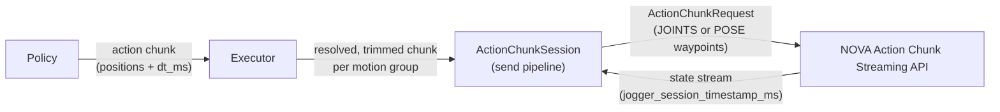
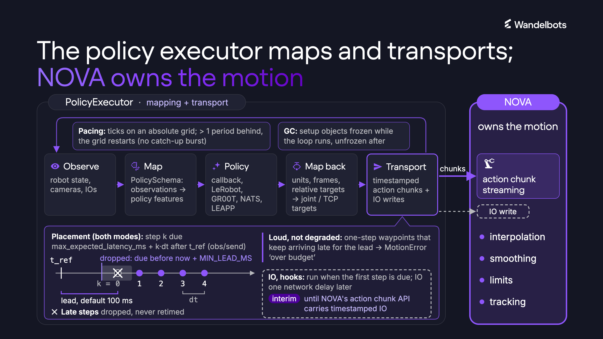

# Notes moved from docs/executor.md

Material moved out of the customer guide [docs/executor.md](../../docs/executor.md): contract and
ADR references, design rationale, measurements, timing internals (the session clock estimate and
its calibration) and known limitations. The text is kept as it was, with links fixed for this
folder.

## Original overview

Advanced internals: how `PolicyExecutor` drives the jogging layer, and how
client and server keep their clocks aligned. For the simple standalone jogging
API (`jog_joints` / `jog_tcp`), see [jogging.md](../../docs/jogging.md).



The executor maps (contracts M1–M11) and places (T1, T2); everything that shapes what is sent
runs in each session's send pipeline, one ordered list of modules (contract T13, ADR 0010).

## Module details (now covered by docs/pipeline.md)

These paragraphs described individual modules. The customer guide links to
[pipeline.md](../../docs/pipeline.md) for them instead.

### Sequential endpoint ramps

A settled executor intentionally lets every submitted waypoint request end, so every request starts
and finishes at zero velocity. The sequential default pipeline's `EndpointRamp()` replaces the
first and final waypoint intervals with three same-`dt_ms` intervals.

The interpolation behaves as follows:

- the first interval uses quadratic ease-in (increasing displacement),
- the final interval uses quadratic ease-out (decreasing displacement),
- a single interval uses smoothstep so both endpoint velocities approach zero.

All original waypoints remain in the request, and IO and computed actions stay with policy
waypoint zero. Each added point retains the
original `dt_ms`, intentionally increasing request duration. Continuous execution does not expose
this setting because every chunk tail is provisional. Its policy client must provide a coherent
initial lookahead and preserve continuity across replacement seams.

### Mutable lookahead smoothing

A timestep queue's plan is smoothed by the `Smoothing` module in its default pipeline: a temporal
`[1, 2, 1] / 4` filter on joint and TCP target sequences. Two passes, the default, are equivalent
to `[1, 4, 6, 4, 1] / 16` away from chunk boundaries. The steps the queue already sent
(`ActionChunk.retained_prefix_steps`) keep exactly the values sent for their timesteps. TCP position and rotation-vector components are filtered independently;
IO actions, timing, and action-timestep metadata remain unchanged. Unlike endpoint interpolation,
smoothing does not add waypoints or change chunk duration.

### Bridging: the timestep queue's timeline

In continuous execution only a timestep queue (`QueuedPolicyClient`) is
bridged (`Bridge(always_anchor=True)`, from its `default_modules`), and only until its timeline
exists: its later chunks carry an `action_timestep`, and the session's `TimestepTimeline` places
them on the first one's timeline without re-anchoring to the measured state.

### Chunk-per-observation queue

Wrap it in `QueuedPolicyClient`: it resolves each chunk to absolute NOVA targets, keeps the steps
that executed during inference (plus `margin_steps`) exactly as published, blends the overlap
0.3/0.7, smooths the plan with that head retained and places it on the executor's timestep
timeline.

## Execution modes: settings belong to their mode

The mode owns every setting that is meaningful to it. In particular, endpoint ramps belong to
`SequentialExecution`; a continuously replaced chunk has no final endpoint to brake at.

## Hold padding: bookkeeping

That
padding is excluded from `scheduled.until_server_ms`, so waits for a chunk to
finish end at the last waypoint the caller asked for rather than sitting through
the hold.

## Teardown: stop on failure

`session.stop()` cancels immediately, which is the point on a
failure path.

## Known limitation: no episode-final signal

The policy API currently has no episode-final signal. Consequently, settled execution brakes every
request endpoint rather than trying to guess which prediction will be the episode's final chunk.

## Stale inputs: why Rerun frames get a looser bound

Frames for the Rerun view are held to a far looser
bound: visualization needs no control-loop freshness, and a stale-frame error from the logging
task would end a run that is otherwise fine. The e-stop monitor ends the run when it has seen no
controller state for 2 s, since an e-stop it cannot see must not leave the robot moving.

## Detecting standstill

`SequentialExecution` promises to observe the robot at rest, so it has to know
when the robot has actually stopped. Two conditions are needed and neither
suffices alone:

1. **The schedule ran out** — every chunk the executor queued was sent
   (`session.scheduled.chunk_count`) and the acknowledged server clock
   (`last_server_timestamp_ms`) has reached `session.scheduled.until_server_ms`,
   the timestamp of the last waypoint the caller asked for. This says the
   deadline elapsed, not that the robot stopped: it is still braking through the
   hold padding that follows.
2. **The joints stopped moving** — `ActionChunkSession.is_at_standstill`.
   Before a chunk's waypoints are reached the robot is legitimately still, so
   this on its own would end the wait before any motion began.

Standstill is measured client-side, from the joint positions in the state
stream, because NOVA reports no "the commanded waypoints ran out" state. Since
26.6 `PAUSED_BY_USER` follows a Pause/Stop *request* only — and the executor
never sends one, since pausing also pauses the session clock the fixed timeline
is anchored on — so a drained queue reports `RUNNING` indefinitely. Relying on
that state instead made every episode execute exactly one chunk and then hang
until the timeout. It is still accepted when it does appear.

`StandstillDetector` holds a *reference* posture and replaces it only once some
joint leaves a small band around it (`_STANDSTILL_EPS_RAD`, ~0.06°); the robot
counts as settled after `_STANDSTILL_HOLD_MS` of server time inside the band.
Holding the reference rather than differencing consecutive samples is what makes
a slow crawl detectable — a creep of less than one epsilon per sample would
otherwise read as standstill forever — while bounded encoder noise never
accumulates out of the band. The hold is measured in server milliseconds, not
sample counts, because state packets arrive in bursts on some deployments.

## Timing: contracts and decisions

The executor maps and transports (see `AGENTS.md`). How the arm follows the waypoints is NOVA's
job; on the client side it owns only when each waypoint is due and when it is sent.



What it promises is listed as numbered, tested invariants in [contracts.md](../contracts.md):
**M** for mapping, **T** for timing. Why each choice was made, with the alternative it was
measured against, is in the [decision records](../adr/).

The lead, `ActionChunkConfig.max_expected_latency_ms`, is 100 ms by default, which fits a policy
running on the NOVA instance. Over a remote network use 150 ms
([ADR 0002](../adr/0002-fixed-lead.md)): on the RL reach over a VPN, the path
deviated by up to 19 mm and lagged by up to 95 mm at 100 ms, 9 mm and 41 mm at 150 ms, and
200 ms was no better. The RL example takes it as `--max-expected-latency-ms 150`.

## One-step joint targets on the cycle grid: mechanism and measurements

NOVA's waypoint follower steers toward the next waypoint every 8 ms cycle with a gain of
1 / (time left), from a state about one cycle old. A waypoint due just after a cycle makes that
gain spike, and the arm follows a smooth one-step policy in pulses around its pace.
`Timestamps(grid_ms=32)` resamples the path of one-step joint targets (the lead path) onto the
multiples of `grid_ms` of the session clock, from now plus `MIN_LEAD_MS` to the newest target,
linearly in between ([ADR 0021](../adr/0021-one-step-targets-on-the-cycle-grid.md)). The path
starts at the robot's joints and continues across requests, so a waypoint sent again keeps its
value.

Measured on a virtual
UR10e over a remote network (LEAPP two-point reach, lead 150 ms, five runs each): the largest
path deviation fell from 11.1 to 5.8 mm and the executed speed ripple from 0.161 to 0.116 rad/s
(means). The RL example takes it as `run_reach.py --grid-ms 32`. It is tuned to the virtual
robot's follower and measured at a 150 ms lead only; the gridded window ends up to one grid step
before the newest target, so check a shorter lead before using it there.

## Timestamp protocol: the session clock estimate

Each waypoint carries a timestamp (milliseconds since session start). The server
maintains an internal clock that starts when the first `ActionChunkRequest` is
received.

The server exposes that clock as `jogger_session_timestamp_ms` in the state
stream (`JoggingDetails`). One server millisecond is one millisecond of motion:
outgoing intervals are **never rescaled**. Deriving a server/client rate ratio and
scaling timestamps by it is the tempting alternative and it is wrong — on a UR10e
the ratio settles near 1.09 and stretches the timeline, slowing all motion by that
proportion.

`JoggingTimeClock` uses the readings only to estimate where the server clock is
now, so that a `now`-anchored chunk can be placed on it:

```
server "now" = last acknowledged jogger_session_timestamp_ms
             + (monotonic now - the instant that state was generated)
```

The elapsed term is measured from when the state was *generated*
(`MotionGroupState.timestamp`), not from when its packet arrived. Packets can be
delivered in bursts, and treating arrival as generation drags the estimate
backwards by the delivery delay. Server/client wall-clock skew is calibrated over
the first state packets of a session and then held fixed; the per-packet delay
correction derived from it is bounded, so a wall-clock step cannot shunt the
estimate far into the future.

The extrapolation itself is deliberately **uncapped**. The jogger timer only
advances once waypoints execute, and waypoints can only be placed once the
estimate advances, so capping it deadlocks startup. A stalled link is warned
about, not clamped — `JoggingTimeClock.max_lookahead_ms` is that warning
threshold, not a limit on the estimate.

Calibration details. The skew is the smallest `local UTC - state UTC` seen; a packet's excess age
over it is its delivery delay, capped at `_MAX_DELIVERY_DELAY_MS` (below `max_lookahead_ms`), since
it comes from wall clocks and an NTP step or an oddly stamped packet would otherwise latch the
never-backwards trajectory clock ahead and hold the robot still. The estimate freezes after a run
of continuously advancing samples (about 200 ms at a 10 ms state rate) or after a time window, so
a slow `state_rate_ms` cannot outlast `wait_ready`'s timeout. Only `observe_state_timestamp`
calibrates; counting a packet in `update` too would freeze it after half its samples. State
timestamps before 2000 are placeholders (FANUC, Stäubli, Techman and Yaskawa controllers stamp
1970-01-01) and are ignored: a constant stamp would read as ever more delivery delay.
`last_sample_wall` is `None` until a jogger timestamp arrives.

An asynchronous policy queue does not use `now` at all: its first bridge assigns
an exact raw controller timestamp to action zero, and every replacement uses
``origin + action_timestep * policy_dt``.

## Unreachable waypoints: bookkeeping

Waypoints whose
timestamp has already passed — plus a small minimum lead
(`drop_late.MIN_LEAD_MS`) — cannot be reached, and commanding them makes
the server jump to catch the trajectory.

Trimming does not move the surviving waypoints: the absolute time-to-position
mapping stays exactly as the caller defined it. It does change which index of the
*sent* request holds the caller's step zero: `scheduled.waypoint_timestamps`
describes the request on the wire, while a chunk's `when_due` step and the policy's
first step (`executing_action_timestep`) keep the timestamps the caller laid out.

A dropped chunk still advances `scheduled.chunk_count`, and its steps keep their
timestamps (all of them in the past, so its `when_due` action runs at once). The
executor waits for `scheduled.chunk_count` to reach what it queued, so a silently
skipped chunk would leave that wait unsatisfiable for the rest of the run.

## Trajectory-absolute timestamps: placement internals

When left at `-1`, the executor anchors automatically (see
`novapolicy/pipeline/placement.py::placement`).

The `now` anchor is resolved at *yield time* (right before the websocket send)
so it cannot go stale while the chunk waits in the session queue.
