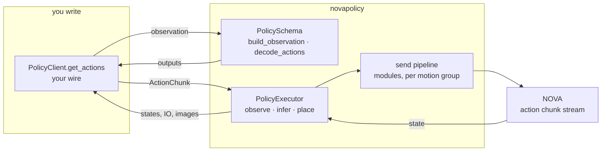
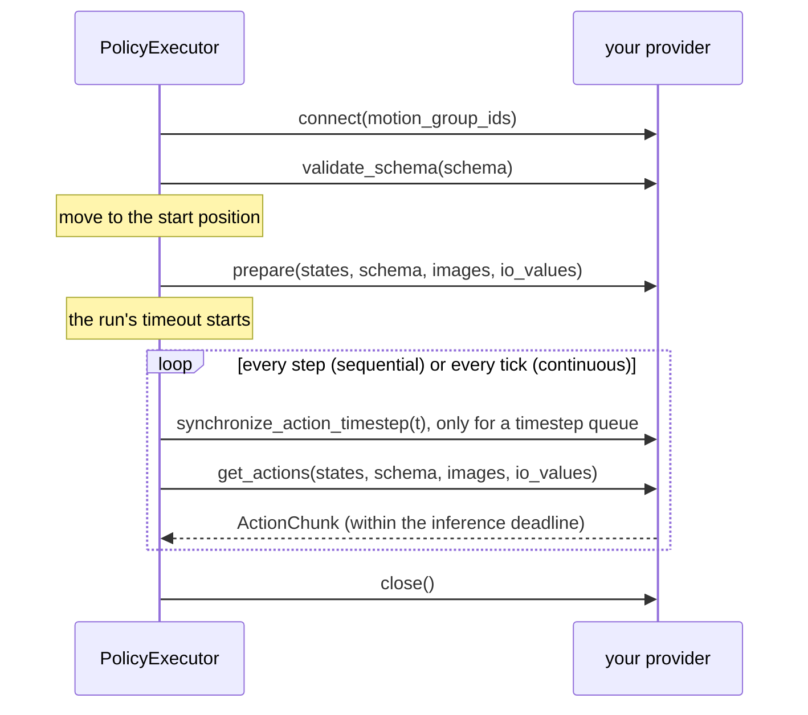

# Adding a policy provider

A provider connects one kind of policy to novapolicy. It owns its wire (HTTP, gRPC, ZMQ, an
in-process runtime) and nothing else. The schema maps NOVA state to the policy's names and units,
and maps the policy's answer back to robot targets. The executor places and streams those targets.

A provider is one class with one required method, `get_actions`.
[`examples/http_policy.py`](../examples/http_policy.py) is a complete provider for a policy served
over HTTP.



## When the executor calls your provider



| Member | Required | Called | Default |
| --- | --- | --- | --- |
| `get_actions(states, schema, images, io_values)` | yes | for every chunk, under the executor's inference deadline | |
| `connect(motion_group_ids)` | no | once, before anything moves | does nothing |
| `validate_schema(schema)` | no | once, before anything moves; raise `ValueError` to refuse | accepts |
| `prepare(states, schema, images, io_values)` | no | once, with the first observation, before the timeout starts | does nothing |
| `close()` | no | once, at the end, also after an error | does nothing |
| `n_action_steps` | no | the policy's own horizon: steps to run per chunk | `None`: all steps |
| `default_modules` | no | send-pipeline modules the policy needs in continuous execution | none |
| `synchronize_action_timestep(t)` | no | before each call, for a timestep queue: the step executing now | does nothing |

## 1. Map the robot to the policy's names

The schema says which robot values the policy sees and which of its outputs drive the robot, in
the policy's names and units. Your provider never converts units or frames.

```python
from novapolicy import Action, Observation, PolicySchema

schema = PolicySchema(
    observations=[Observation.joint_positions("arm", source=mg, action=False)],
    actions=[Action.joint_positions("arm", target=mg, mode="absolute")],
)
```

[schema.md](schema.md) covers TCP poses, IO, operators (`Scale`, `Rad2Deg`), frames and relative
targets.

## 2. Write the provider

The schema hands you the observation in one format and takes the answer back in one format,
both by key:

| | Format | Example |
| --- | --- | --- |
| observation | `schema.observation_groups(...)`: one vector per key | `{"arm": [6 values], "gripper": [1.0]}` |
| answer | outputs for `schema.decode_actions(...)`: one row per step per key | `{"arm": [[6 values], ...], "gripper": [[0.0], ...]}` |

A provider opens its wire in `connect`, sends the observation in `get_actions` and closes the wire
in `close`. Only the wire is yours; `wire` stands for your own protocol object:

```python
from novapolicy import PolicyClient, resolve_control_freq


class MyPolicyClient(PolicyClient):
    def __init__(self, wire, *, control_freq: float | None = None) -> None:
        self._wire = wire  # the provider's own protocol
        self._dt_ms = 1000.0 / resolve_control_freq(control_freq, owner="MyPolicyClient")

    async def connect(self, motion_group_ids: list[str]) -> None:
        await self._wire.open()

    async def get_actions(self, states, schema, images=None, io_values=None):
        observation = await schema.build_observation(states, io_values)
        groups = schema.observation_groups(observation)  # {"arm": [6 values], ...}
        outputs = await self._wire.infer(groups, images)  # {"arm": [[6 values], ...]}
        return schema.decode_actions(outputs, dt_ms=self._dt_ms, source="MyPolicy")

    async def close(self) -> None:
        await self._wire.close()
```

**If your wire wants another format**, convert at the wire, not in between. The shipped
providers need these two:

- *One flat vector.* A LeRobot checkpoint takes one `observation.state` and answers one flat row
  per step. `schema.flatten(groups)` joins the vectors in schema order.
  `schema.unflatten(rows, dof=...)` cuts the rows back into outputs by key: joints, TCP, IO, then
  computed actions, `dof` joints per motion group.

  ```python
  dof = {group_id: len(state.joints) for group_id, state in states.items()}
  rows = await self._wire.infer(schema.flatten(groups))
  outputs = schema.unflatten(rows, dof=dof, source="MyPolicy")
  ```

- *Arrays.* A GR00T server takes and returns float32 arrays. Convert each vector, and convert
  the answer back to lists.

  ```python
  answer = await self._wire.infer({k: np.asarray(v, np.float32) for k, v in groups.items()})
  outputs = {k: np.asarray(v).tolist() for k, v in answer.items()}
  ```

`dt_ms` is the policy's step spacing. Take it from the training data's frame rate
(`control_freq=`), or from what the policy reports (`resolve_control_freq(..., recorded=...)`).
A one-step policy (reinforcement learning) answers one row per call; the code is the same.

You do not write timestamps, bridging from the robot's position, clamping to joint limits, holds
at the end of a chunk or IO timing. The executor and the send pipeline do those for every
provider; see [pipeline.md](pipeline.md).

## 3. Refuse what the policy cannot serve

Fail before the robot moves. If your wire can describe the policy, compare it with the schema:

```python
    async def validate_schema(self, schema):
        spec = await self._wire.describe()  # e.g. {"observations": ["arm", "gripper"], ...}
        missing = [key for key in spec["observations"] if schema.observation_kind(key) is None]
        if missing:
            msg = f"The policy needs observations the schema does not declare: {missing}"
            raise ValueError(msg)
```

Decoding also checks every chunk. A joint key with too few columns for its motion groups, or rows
narrower than the action columns, raise an error instead of moving the robot.

## 4. Choose how it runs

| Your policy | Execution |
| --- | --- |
| answers a chunk, the robot runs it to standstill, then it is asked again | `SequentialExecution()` |
| answers a chunk and is asked again while the robot moves | `ContinuousExecution(rate_hz=...)`, client wrapped in `QueuedPolicyClient(...)` |
| answers one step (reinforcement learning) | `ContinuousExecution(rate_hz=control_freq)` |

`QueuedPolicyClient` keeps one timeline across overlapping chunks and adds the modules that
timeline needs (`Smoothing`, `TimestepTimeline`, `Bridge`). It requires `ContinuousExecution`;
the executor refuses it with `SequentialExecution`.

```python
from novapolicy import ContinuousExecution, PolicyExecutor, QueuedPolicyClient

result = await PolicyExecutor(
    schema,
    QueuedPolicyClient(MyPolicyClient(wire, control_freq=30)),
    execution=ContinuousExecution(rate_hz=10),
    start_joint_position={mg: HOME},
    timeout_s=30.0,
).run()
```

## 5. Test it without a robot

Give the provider a fake wire and check the chunk it returns. The package's own test of the
provider above does it like this:

```python
class EchoWire:
    async def open(self):
        pass

    async def infer(self, observation, images):
        return {"arm": [[0.1] * 6, [0.2] * 6]}

    async def close(self):
        pass


client = MyPolicyClient(EchoWire(), control_freq=20)
await client.connect([mg.id])
chunk = await client.get_actions({mg.id: SimpleNamespace(joints=(0.0,) * 6)}, schema)
await client.close()
assert chunk.dt_ms == 50.0 and chunk.joints[mg.id] == [[0.1] * 6, [0.2] * 6]
```

## 6. Run it on a virtual robot

Create a throwaway virtual controller and run the executor against it before any real robot.
`test_a_new_provider_over_http` in
[`tests/integration/test_pipeline_live.py`](../tests/integration/test_pipeline_live.py) runs the
HTTP example continuously and sequentially and checks that the arm followed what was commanded.
Copy it for your provider.

## What the shipped providers add

| Provider | Wire | Beyond `get_actions` |
| --- | --- | --- |
| [`examples/http_policy.py`](../examples/http_policy.py) | JSON over HTTP | nothing |
| `LeappPolicyClient` | onnxruntime, in process | reads the exported ports and rate from the LEAPP export |
| `Gr00tPolicyClient` | ZMQ, msgpack | takes state and language keys from the server, checks the checkpoint's statistics, rot6d TCP default |
| `LeRobotPolicyClient` | gRPC, pickle | checks the checkpoint's feature contract and statistics |

## Troubleshooting

| Symptom | What to do |
| --- | --- |
| `ValueError` from `decode_actions` about columns or row width | The answer does not fit the schema's actions. Check the width per key, and `dof` for a flat wire. |
| `ValueError: ... requires ContinuousExecution` | Use `ContinuousExecution`, or drop `QueuedPolicyClient` for `SequentialExecution`. |
| `ValueError: ... numbers its steps` | Your own `pipeline=` lacks the queue's modules. Build it from `default_pipeline(execution=..., policy=...)`. |
| A warning that the client got no `control_freq` | Pass the training data's frame rate as `control_freq=`. Without it, actions play at 30 Hz. |
| `RuntimeError: Stale policy input (inference exceeded 30s)` | `get_actions` took longer than `PolicyExecutor(inference_timeout_s=...)`. Check the wire, or raise the deadline. |
