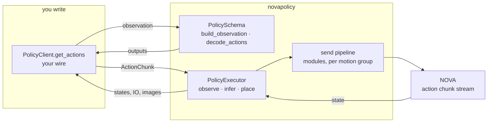
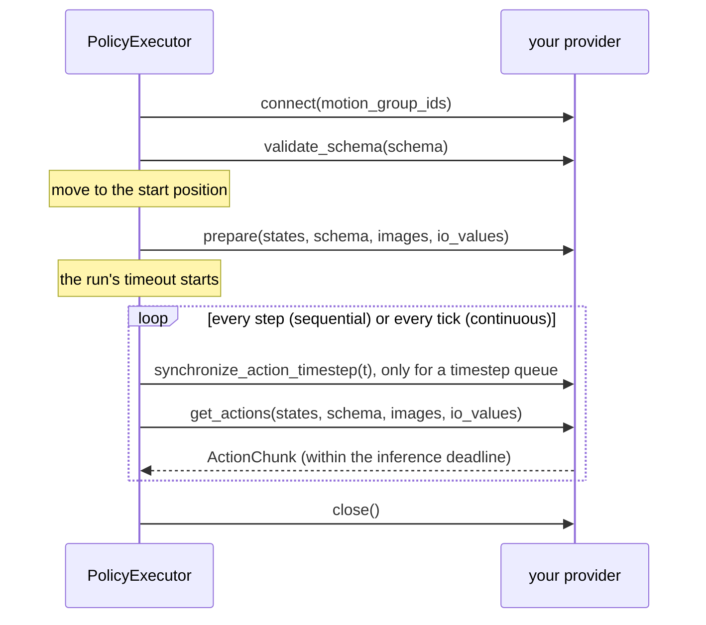

# Adding a policy provider

A provider connects one kind of policy to novapolicy. It owns its wire (HTTP, gRPC, ZMQ, an
in-process runtime) and nothing else: the schema maps NOVA state to the policy's names and units
and the policy's answer back to robot targets, and the executor places and streams those targets
([ADR 0011](adr/0011-providers-own-their-wire.md)). A provider is one class with one required
method, `get_actions`. [`examples/http_policy.py`](../examples/http_policy.py) is a complete one in
26 lines of code, written against this contract without changing the package.



## When the executor calls your provider



| Member | Required | Called | Default |
| --- | --- | --- | --- |
| `get_actions(states, schema, images, io_values)` | yes | for every chunk, under the executor's inference deadline | |
| `connect(motion_group_ids)` | no | once, before anything moves | does nothing |
| `validate_schema(schema)` | no | once, before anything moves; raise `ValueError` to refuse | accepts |
| `prepare(states, schema, images, io_values)` | no | once, with the first observation, before the timeout starts | does nothing |
| `close()` | no | once, at the end, also after an error | does nothing |
| `n_action_steps` | no | the policy's own horizon: steps to run per chunk | `None`: all steps |
| `default_modules` | no | send-pipeline modules the policy needs in continuous execution | none |
| `synchronize_action_timestep(t)` | no | before each call, for a timestep queue: the step executing now | does nothing |

## 1. Map the robot to the policy's names

The schema says which robot values the policy sees and which of its outputs drive the robot, in
the policy's names and units. Your provider never converts units or frames.

```python
from novapolicy import Action, Observation, PolicySchema

schema = PolicySchema(
    observations=[Observation.joint_positions("arm", source=mg, action=False)],
    actions=[Action.joint_positions("arm", target=mg, mode="absolute")],
)
```

[schema.md](schema.md) covers TCP poses, IO, operators (`Scale`, `Rad2Deg`), frames and relative
targets.

## 2. Write `get_actions` for your wire's shape

Every provider has the same three lines: build the observation with the schema, send it over the
wire, decode the answer with the schema. Only the middle line is yours, and how the answer comes
back decides which schema helper fits.

**Outputs by key** (JSON over HTTP, NATS, most services): the answer is `{key: [[...], ...]}`, one
row per step.

```python
from novapolicy import PolicyClient, resolve_control_freq


class MyPolicyClient(PolicyClient):
    def __init__(self, wire, *, control_freq: float | None = None) -> None:
        self._wire = wire
        self._dt_ms = 1000.0 / resolve_control_freq(control_freq, owner="MyPolicyClient")

    async def get_actions(self, states, schema, images=None, io_values=None):
        observation = await schema.build_observation(states, io_values)  # {"arm_1": ..., ...}
        outputs = await self._wire.infer(observation, images)  # {"arm": [[...6], ...]}
        return schema.decode_actions(outputs, dt_ms=self._dt_ms, source="MyPolicy")
```

**One flat vector** (LeRobot-style): the policy takes one state vector and answers flat rows.
`observation_groups` gives one vector per key in schema order; `action_columns` and
`split_actions` cut the rows back into outputs by key.

```python
    async def get_actions(self, states, schema, images=None, io_values=None):
        observation = await schema.build_observation(states, io_values)
        state = [v for vector in schema.observation_groups(observation).values() for v in vector]
        rows = await self._wire.infer(state)  # [[a0, a1, ...], ...], one row per step
        dof = {group_id: len(s.joints) for group_id, s in states.items()}
        outputs = schema.split_actions(rows, schema.action_columns(dof), source="MyPolicy")
        return schema.decode_actions(outputs, dt_ms=self._dt_ms, dof=dof, source="MyPolicy")
```

**One array per key** (GR00T-style): `observation_groups` already is that.

```python
    async def get_actions(self, states, schema, images=None, io_values=None):
        observation = await schema.build_observation(states, io_values)
        arrays = {k: np.asarray(v, np.float32) for k, v in schema.observation_groups(observation).items()}
        outputs = await self._wire.infer(arrays)  # {key: array (steps, width)}
        return schema.decode_actions(
            {k: np.asarray(v).tolist() for k, v in outputs.items()}, dt_ms=self._dt_ms, source="MyPolicy"
        )
```

`dt_ms` is the policy's step spacing. Take it from the training data's frame rate
(`control_freq=`), or from what the policy reports (`resolve_control_freq(..., recorded=...)`).
A one-step policy (reinforcement learning) answers one row per call; it is the same code.

What you do not write: timestamps, bridging from the robot's position, clamping to joint limits,
holds at the end of a chunk, IO timing. The executor and the send pipeline do those for every
provider ([architecture.md](architecture.md#the-send-pipeline)).

## 3. Refuse what the policy cannot serve

Fail before the robot moves. If your wire can describe the policy, compare it with the schema:

```python
    async def validate_schema(self, schema):
        spec = await self._wire.describe()  # e.g. {"observations": ["arm", "gripper"], ...}
        missing = [key for key in spec["observations"] if schema.observation_kind(key) is None]
        if missing:
            raise ValueError(f"The policy needs observations the schema does not declare: {missing}")
```

Decoding also checks every chunk: a joint key with too few columns for its motion groups, or rows
narrower than the action columns, raise instead of moving the robot
([ADR 0014](adr/0014-providers-fail-before-motion.md)).

## 4. Choose how it runs

| Your policy | Execution |
| --- | --- |
| answers a chunk, robot runs it to standstill, then asks again | `SequentialExecution()` |
| answers a chunk, asked again while the robot moves | `ContinuousExecution(rate_hz=...)`, wrap the client in `QueuedPolicyClient(...)` |
| answers one step (reinforcement learning) | `ContinuousExecution(rate_hz=control_freq)` |

`QueuedPolicyClient` keeps one timeline across overlapping chunks and brings the modules that need
(`Smoothing`, `TimestepTimeline`, `Bridge`); the executor knows nothing about queues.

```python
from novapolicy import ContinuousExecution, PolicyExecutor, QueuedPolicyClient

result = await PolicyExecutor(
    schema,
    QueuedPolicyClient(MyPolicyClient(wire, control_freq=30)),
    execution=ContinuousExecution(rate_hz=10),
    start_joint_position={mg: HOME},
    timeout_s=30.0,
).run()
```

## 5. Test it without a robot

Give the provider a fake wire and check the chunk it returns. This is how
`test_a_provider_is_a_transport_and_the_schema_does_the_mapping` tests the snippet above:

```python
class EchoWire:
    async def infer(self, observation, images):
        return {"arm": [[0.1] * 6, [0.2] * 6]}


chunk = await MyPolicyClient(EchoWire(), control_freq=20).get_actions(
    {mg.id: SimpleNamespace(joints=(0.0,) * 6)}, schema
)
assert chunk.dt_ms == 50.0 and chunk.joints[mg.id] == [[0.1] * 6, [0.2] * 6]
```

## 6. Run it on a virtual robot

Create a throwaway virtual controller and run the executor against it before any real robot.
`test_a_new_provider_over_http` in
[`tests/integration/test_pipeline_live.py`](../tests/integration/test_pipeline_live.py) runs the
HTTP example continuously and sequentially and checks that the arm followed what was commanded;
copy it for your provider.

## What the shipped providers add on top

| Provider | Wire | Beyond `get_actions` |
| --- | --- | --- |
| [`examples/http_policy.py`](../examples/http_policy.py) | JSON over HTTP | nothing |
| `LeappPolicyClient` | onnxruntime, in process | reads the exported ports and rate from the LEAPP export |
| `Gr00tPolicyClient` | ZMQ, msgpack | takes state and language keys from the server, checks the checkpoint's statistics, rot6d TCP default |
| `LeRobotPolicyClient` | gRPC, pickle | checks the checkpoint's feature contract and statistics |

The [architecture page](architecture.md#adding-a-policy-provider) lists their code sizes.
