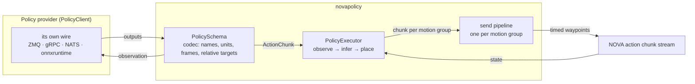
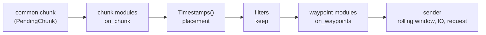
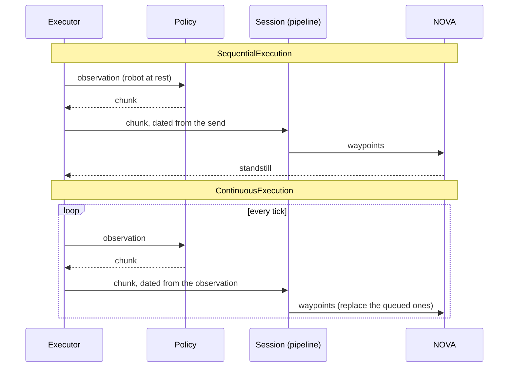

# Architecture

novapolicy runs a trained policy on NOVA robots. It does two things: **mapping** (robot state,
IO and images into the policy's names and units, and the policy's answer back into NOVA joint or
TCP targets) and **transport** (placing those targets on NOVA's clock and streaming them as
action chunks). NOVA owns the motion: profiles, interpolation, limits, IK
([ADR 0001](adr/0001-map-and-transport.md)). Everything that works around a limitation of the
action chunk streaming interface is a module you can switch on or off.



## The send pipeline

Every chunk a policy, a jogger or a replay produces passes one ordered list of modules per motion
group, a pipes-and-filters chain over one message type, the `PendingChunk`
([ADR 0009](adr/0009-opt-in-pre-send-modules.md), [ADR 0010](adr/0010-built-ins-are-modules.md)):



| Kind | Sees | May change | Built-ins |
| --- | --- | --- | --- |
| chunk module | every chunk, when queued | steps and timing | `Smoothing`, `TimestepTimeline`, `Bridge`, `EndpointRamp`, `JointClamp`, `LiveBuffer`, `HoldPadding` |
| `Timestamps()` | the chunk | each step's time (contracts T1, T2) | placement |
| filter | the timed waypoints | which go out, never their time | `DropLate` |
| waypoint module | the timed waypoints, at every send | values only | `EaseIn` |

**Enable and disable parts** by passing the list: `pipeline=None` runs `default_pipeline(...)`; an
explicit list is exactly what runs. Extend or edit the defaults:

```python
from novapolicy import EaseIn, HoldPadding, LiveBuffer, default_pipeline

jog_joints(mg, pipeline=[LiveBuffer(window_ms=500), *default_pipeline()])  # add one
jog_joints(mg, pipeline=[*default_pipeline(), EaseIn(duration_s=1.0)])  # add one
defaults = default_pipeline(execution=execution, policy=policy)
PolicyExecutor(..., pipeline=[m for m in defaults if not isinstance(m, HoldPadding)])  # drop one
```

### The defaults

| Who | Default pipeline |
| --- | --- |
| `jog_joints`, `jog_tcp` | `HoldPadding` → `Timestamps` → `DropLate` |
| `PolicyExecutor`, `SequentialExecution` | `Bridge` → `EndpointRamp` → `JointClamp` → `HoldPadding(after_ms=300)` → `Timestamps` → `DropLate` |
| `PolicyExecutor`, `ContinuousExecution` | the policy's `default_modules` → `JointClamp` → `HoldPadding` → `Timestamps` → `DropLate` |
| a timestep queue's `default_modules` | `Smoothing` → `TimestepTimeline` → `Bridge(always_anchor=True)` |

```mermaid
flowchart TB
    subgraph seq["SequentialExecution"]
        direction LR
        s1[Bridge] --> s2[EndpointRamp] --> s3[JointClamp] --> s4[HoldPadding] --> s5[Timestamps] --> s6[DropLate]
    end
    subgraph cont["ContinuousExecution with a timestep queue"]
        direction LR
        c0[Smoothing] --> c1[TimestepTimeline] --> c2["Bridge(always_anchor)"] --> c3[JointClamp] --> c4[HoldPadding] --> c5[Timestamps] --> c6[DropLate]
    end
    subgraph jog["jog_joints / jog_tcp, with the opt-in modules"]
        direction LR
        j0["LiveBuffer (opt-in)"] --> j1[HoldPadding] --> j2[Timestamps] --> j3[DropLate] --> j4["EaseIn (opt-in)"]
    end
```



| Module | Works around | Off by |
| --- | --- | --- |
| `Bridge` | a policy's first step far from the robot would be a jump | leaving it out |
| `EndpointRamp` | each sequential chunk starts and ends at rest | leaving it out |
| `JointClamp` | an out-of-range target pauses the motion | leaving it out |
| `HoldPadding` | a short chunk ends without a braking horizon; in sequential execution, an arm still moving at the last step brakes past it (held 300 ms after it) | leaving it out (use `delay_until_braking_ms`) |
| `DropLate` | a waypoint already due makes the controller jump back | leaving it out |
| `Smoothing` | blending overlapping plans leaves kinks | leaving it out |
| `TimestepTimeline` | a queue's replacements must continue its timeline | (required for a queue) |
| `LiveBuffer` | a lone live target is a terminal target the robot brakes to | not adding it |
| `EaseIn` | a time-based target with velocity at t=0 lunges from rest | not adding it |

## Execution modes



One placement rule serves both ([ADR 0003](adr/0003-one-placement-rule.md)): step `k` is due
`reference + max_expected_latency_ms + k·dt`, the reference being the observation in continuous
and the send in sequential execution. A one-step chunk (an RL policy) is the same rule with one
step; a chunk that numbers its steps (a timestep queue) is placed by its `TimestepTimeline`.

## Adding a policy provider

A provider is a `PolicyClient` with a transport. The schema does the mapping in both directions,
so the provider only names things in its own wire format (this snippet runs as a test,
`test_a_provider_is_a_transport_and_the_schema_does_the_mapping`):

```python
from novapolicy import PolicyClient, resolve_control_freq


class MyPolicyClient(PolicyClient):
    def __init__(self, url: str, *, control_freq: float | None = None) -> None:
        self._wire = MyWire(url)  # the provider's own protocol
        self._dt_ms = 1000.0 / resolve_control_freq(control_freq, owner="MyPolicyClient")

    async def connect(self, motion_group_ids: list[str]) -> None:
        await self._wire.open()

    async def get_actions(self, states, schema, images=None, io_values=None):
        observation = await schema.build_observation(states, io_values)  # names -> values
        outputs = await self._wire.infer(observation, images)  # {action key: (T, w)}
        return schema.decode_actions(outputs, dt_ms=self._dt_ms, source="MyPolicy")

    async def close(self) -> None:
        await self._wire.close()
```

Optional members, each with a no-op default: `validate_schema` (refuse a schema the policy cannot
serve), `prepare` (setup before the timeout starts), `n_action_steps` (the policy's own horizon),
`default_modules` (modules the policy needs in continuous execution) and
`synchronize_action_timestep` (for a timestep queue: which step the robot executes now). Wrap a
chunk-per-observation provider in `QueuedPolicyClient` to make it a timestep queue
([ADR 0011](adr/0011-providers-own-their-wire.md)).

What a provider costs, measured in code lines (without docstrings, comments and blank lines). The
executor, the session and the jogger name no provider: adding one touches none of them.

| Provider | `get_actions` | client | its wire | its own extras |
| --- | --- | --- | --- | --- |
| the snippet above | 3 | 15 | yours | none |
| HTTP, JSON ([example](../examples/http_policy.py), written against this contract: 0 package lines changed) | 6 | 26 | `httpx` | none |
| LEAPP (onnxruntime, in process) | 37 | 154 | 146 (`pipeline.py`) | the ONNX pipeline's ports |
| GR00T (ZMQ, msgpack) | 26 | 277 | 155 | server modality keys, checkpoint statistics, rot6d TCP |
| LeRobot (gRPC, pickle) | 30 | 259 | 96 | checkpoint feature contract (`schema.py`, `config.py`: 403) |
| NATS (request/reply) | 33 | 352 | 189 | proprioception blocks and the protocol's error codes |

Everything beyond `get_actions` is the provider's wire and the checks its checkpoint format allows;
mapping, decoding, placement and streaming come from the package.

## Where things live

| Concern | Module |
| --- | --- |
| mapping, units, frames, relative targets, decoding | `novapolicy/schema.py`, `ops.py`, `poses.py`, `chunking.py` |
| loop, IO and computed actions, cameras | `novapolicy/executor.py` |
| placement (lead, hold padding) | `novapolicy/chunking.py` (`placement`) |
| building one session per motion group, start move, e-stop monitor, fault and stop-condition checks, drain (executor and jogger) | `novapolicy/jogging/lifecycle.py` |
| send pipeline, modules | `novapolicy/jogging/pipeline.py`, `modules.py`, `live_buffer.py` |
| NOVA transport: stamping and sending (`_schedule`), what was sent (`scheduled`) | `novapolicy/jogging/waypoint_session.py`, `clock.py` |
| jogging state, standstill, stop conditions (`first_fired`) | `novapolicy/jogging/session.py` |
| e-stop stream | `novapolicy/estop.py` |
| jogging API | `novapolicy/jogging/jogger.py` |
| providers | `novapolicy/gr00t/`, `lerobot/`, `nats/`, `leapp/`, `queued_client.py` |
| visualization | `novapolicy/rerun/` |

The contracts every part keeps are in [contracts.md](contracts.md), each with its tests; why each
decision was taken is in the [decision records](adr/README.md).
