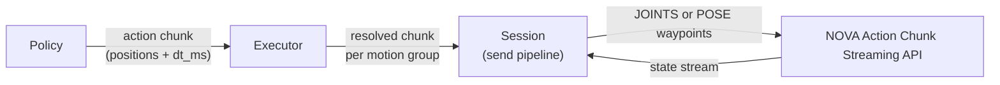

# PolicyExecutor: execution modes and timing

`PolicyExecutor` runs one policy episode on NOVA. In a loop it observes the robot, asks the
policy for an action chunk, and sends the actions to NOVA, until a timeout, a stop condition or
`stop()`. This page covers how to choose an execution mode, how to tune timing, and how a run
ends. To move a robot without a policy, see [jogging.md](jogging.md). For the schema, see
[schema.md](schema.md).

## Quick start

```python
from novapolicy import PolicyExecutor, SequentialExecution

executor = PolicyExecutor(
    schema,  # a PolicySchema
    policy,  # a PolicyClient, for example Gr00tPolicyClient or CallbackPolicyClient
    execution=SequentialExecution(),
    timeout_s=60.0,
)
result = await executor.run()
print(result.reason, result.steps, result.duration_s)
```

`PolicyExecutor` accepts `PolicyClient` instances only. Wrap a local async function with
`CallbackPolicyClient`. The backend clients (`Gr00tPolicyClient`, `LeRobotPolicyClient`,
`LeappPolicyClient`) implement the interface directly.



## Choosing an execution mode

| mode | behavior | use case |
| --- | --- | --- |
| `SequentialExecution()` (default) | runs each chunk to the end, waits until the robot stands still, then asks the policy again | settled, step-by-step inference |
| `ContinuousExecution()` | replaces the running chunk as fast as inference allows | asynchronous inference |
| `ContinuousExecution(rate_hz=20)` | replaces the running chunk at a fixed rate | rate-controlled asynchronous inference |

```python
from novapolicy import (
    ContinuousExecution,
    PolicyExecutor,
    SequentialExecution,
    ActionChunkConfig,
)

config = ActionChunkConfig(state_rate_ms=10)

# Complete and settle every chunk before the next inference.
sequential = PolicyExecutor(
    schema,
    policy,
    motion=config,
    execution=SequentialExecution(),
    n_action_steps=8,
)

# Replace lookaheads continuously at 20 Hz.
continuous_fixed = PolicyExecutor(
    schema,
    policy,
    motion=config,
    execution=ContinuousExecution(rate_hz=20),
    n_action_steps=8,
)

# Replace lookaheads as fast as inference allows.
continuous_asap = PolicyExecutor(
    schema,
    policy,
    execution=ContinuousExecution(),
)
```

### `SequentialExecution`

```
1. Observe robot state
2. Query policy → get action chunk
3. Bridge from the observed state when the first target is farther than normal waypoint spacing
4. Send bridge + policy waypoints as one continuous request
5. Wait until the last waypoint is due and the robot stands still
6. Go to 1
```

Each chunk starts and ends at rest, and holds its last target for 300 ms after its last step.
The wait ends at the chunk's last step once the robot stands still, so each cycle can take up to
300 ms longer than the chunk itself, plus inference time.

### `ContinuousExecution`

```
1. Observe robot state
2. Query policy → get action chunk
3. Send waypoints to NOVA (replaces the previous chunk)
4. If `rate_hz` is set, sleep until the next fixed-rate tick
5. Go to 1
```

The executor works as a receding-horizon controller: each new chunk overlaps the previous one.
NOVA replaces the waypoints from the new chunk's first timestamp onward.
This mode supports asynchronous action queues such as ACT.


The overlap is a **hard replace, not a blend**. From the new chunk's first timestamp onward, the
previous chunk's remaining targets are discarded (the faded dashed tail) and the new chunk's
values are used as they are. The robot does not jump: it moves from its actual position toward
the new targets, within its velocity and acceleration limits (the white line). The policy client
must keep the overlap consistent, or smooth it, for example with an asynchronous action queue
(see [below](#continuous-execution-for-chunk-per-observation-policies)).

- Higher rates give smoother overlap but need faster inference. With 20 Hz and 1 s chunks,
  consecutive chunks overlap by about 95%.
- If no new chunk arrives before the previous one ends, the robot stops.
- Chunks shorter than 500 ms are padded by repeating their last target, so NOVA can always brake
  within the horizon. One-step chunks are not padded in continuous execution, because the next
  step replaces them.

### How many steps run: `n_action_steps`

| value | steps executed from each chunk |
| --- | --- |
| `None` (default) | the horizon the policy declares (a `LeRobotPolicyClient` reports its checkpoint's `n_action_steps`), else all |
| `0` | all returned steps; use it for a continuous asynchronous queue |
| `N > 0` | the first `N` steps |

Trimming is a receding horizon: later steps are less certain and are discarded, while the policy
still predicts its full horizon (for example 16 steps), which an asynchronous client can keep.

## Continuous execution for chunk-per-observation policies

A policy that answers each observation with a new chunk and keeps no queue of its own
(`Gr00tPolicyClient`, a `CallbackPolicyClient`) makes the arm jump at every replacement. Wrap it
in `QueuedPolicyClient`. It keeps the steps that ran during inference (plus `margin_steps`, 2 by
default) as they were sent, blends the overlap with the new chunk, smooths the plan, and keeps
all chunks on one timeline. Wrap a `LeRobotPolicyClient` the same way.

```python
from novapolicy import (
    ContinuousExecution,
    Gr00tPolicyClient,
    PolicyExecutor,
    QueuedPolicyClient,
)

executor = PolicyExecutor(
    schema,
    QueuedPolicyClient(Gr00tPolicyClient(host, port=port, control_freq=30)),
    execution=ContinuousExecution(),
    n_action_steps=0,  # keep the whole horizon as lookahead
)
```

`QueuedPolicyClient` needs `ContinuousExecution`. With `SequentialExecution` the executor raises
`ValueError` at construction.

## Bridging a distant first waypoint

When a policy's first waypoint is far from the robot, the `Bridge` module (in the sequential
default pipeline) connects the measured position to the predicted motion. The bridge and the
policy chunk are sent as one request, so NOVA does not stop between them, and IO or computed
actions stay aligned with the policy's first waypoint.

In continuous execution only a `QueuedPolicyClient` is bridged, and only until its timeline is
set up by its first chunk.
Its pipeline must contain a `TimestepTimeline`; the executor refuses one without it at
construction. `default_pipeline(execution=..., policy=...)` includes it.

## Customizing the send pipeline

Everything that shapes what is sent runs in an ordered list of modules. With `pipeline=None` the
executor runs `default_pipeline(execution=..., policy=...)`:

| execution | default pipeline |
| --- | --- |
| `SequentialExecution` | `Bridge`, `EndpointRamp`, `JointClamp`, `HoldPadding(after_ms=300)`, `Timestamps`, `DropLate` |
| `ContinuousExecution` | `JointClamp`, `HoldPadding`, `Timestamps`, `DropLate` |
| `ContinuousExecution` with `QueuedPolicyClient` | `Smoothing`, `TimestepTimeline`, `Bridge(always_anchor=True)`, `JointClamp`, `HoldPadding`, `Timestamps`, `DropLate` |

An explicit `pipeline` is exactly what runs. Start from the default list and edit it, rather
than writing one from scratch. Pass the same `execution` and `policy` to `default_pipeline` as to
the executor. What each module does is in [pipeline.md](pipeline.md).

Replace a module, for example a longer endpoint ramp in sequential execution:

```python
from novapolicy import EndpointRamp, PolicyExecutor, SequentialExecution, default_pipeline

execution = SequentialExecution()
defaults = default_pipeline(execution=execution, policy=policy)

custom = PolicyExecutor(
    schema,
    policy,
    execution=execution,
    pipeline=[
        EndpointRamp(interpolation_steps=4) if isinstance(m, EndpointRamp) else m for m in defaults
    ],
)
```

Remove a module:

```python
disabled = PolicyExecutor(
    schema,
    policy,
    execution=execution,
    pipeline=[m for m in defaults if not isinstance(m, EndpointRamp)],
)
```

Add a module:

```python
from novapolicy import EaseIn

pipeline = [*default_pipeline(execution=execution, policy=policy), EaseIn(duration_s=1.0)]
executor = PolicyExecutor(schema, policy, execution=execution, pipeline=pipeline)
```

`EndpointRamp` brings every chunk to rest. In `ContinuousExecution` it makes the arm stop at each
replacement, and the executor logs a warning.

## Timing

### When each step is due

Step `k` of a chunk is due `reference + max_expected_latency_ms + k·dt` on the session clock, in
both modes:

- In continuous execution the reference is the moment the observation was taken.
- In sequential execution the reference is the send. The robot was at rest when it was observed.

Steps whose time has already passed when the chunk is sent are dropped, never retimed. IO and
computed actions run when the policy's first step is due.

### Setting the lead for your network

The lead, `ActionChunkConfig.max_expected_latency_ms`, is 100 ms by default. That fits a policy
running on the NOVA instance. Over a remote network, use 150 ms:

```python
from novapolicy import PolicyExecutor, ActionChunkConfig

executor = PolicyExecutor(schema, policy, motion=ActionChunkConfig(max_expected_latency_ms=150))
```

The arm follows the policy by this much. A lead that is too short for the network makes steps
arrive late, so they are dropped and the path deviates. The RL example takes it as
`--max-expected-latency-ms 150`.

### One-step joint targets on the cycle grid (`Timestamps(grid_ms=...)`)

A policy that returns one joint target per step can make the arm move in small pulses around its
pace. `Timestamps(grid_ms=32)` puts those one-step joint targets on a fixed time grid on the
session clock, interpolating linearly between them. It applies only to one-step joint targets.
Multi-step chunks, TCP targets and chunks with their own timeline keep their times.

It is off by default. Swap it into the default list:

```python
from novapolicy import ContinuousExecution, PolicyExecutor, Timestamps, default_pipeline

execution = ContinuousExecution(rate_hz=30)
pipeline = [
    Timestamps(grid_ms=32) if isinstance(m, Timestamps) else m
    for m in default_pipeline(execution=execution, policy=policy)
]
executor = PolicyExecutor(schema, policy, execution=execution, pipeline=pipeline)
```

Choose the multiple of 8 ms closest to the policy's step: 32 for 30 Hz. The RL example takes it
as `run_reach.py --grid-ms 32`.

## Timestamp protocol

Each waypoint carries a timestamp in milliseconds on the session clock. The session clock starts
when NOVA receives the first request.

### Trajectory-absolute timestamps

To make overlapping chunks line up, a policy can place a chunk at an explicit point on the
session clock with `ActionChunk.first_timestamp_ms`. Identical steps then land at identical
timestamps, and NOVA joins them into one trajectory instead of restarting at every resend.

```python
ActionChunk(
    joints={"0@ur10e": chunk_steps},
    dt_ms=10.0,
    first_timestamp_ms=int(step_idx * 10.0),  # explicit absolute anchor
)
```

A chunk with its own `first_timestamp_ms` is never bridged. When left at `-1` (the default), the
executor places step 0 as follows:

| case | anchor | offset |
| --- | --- | --- |
| explicit `first_timestamp_ms >= 0` | that value | `0` (exact) |
| `SequentialExecution` | the send on the server's clock + `max_expected_latency_ms` | step `k` at `+ k·dt`; nothing is late |
| `ContinuousExecution`, chunk from the latest observation | the observation time on the server's clock + `max_expected_latency_ms` | step `k` at `+ k·dt`; steps too close to send are dropped |
| `ContinuousExecution`, chunk with its own timeline (policy timestep, bridge) | `now` | `0` |

### Unreachable waypoints are trimmed

A chunk is timestamped when it is built and sent a moment later. Leading waypoints whose time has
already passed cannot be reached, so they are dropped at send time and the rest is sent. A chunk
whose waypoints have all passed is dropped. The waypoints that are sent keep their timestamps, so
the trajectory is not distorted.

## Stale inputs and how a run ends

A camera can freeze and a policy service can hang. Each camera channel has a freshness bound. A
frame older than its bound, or an inference that takes longer than `inference_timeout_s`, ends
the run with `RuntimeError("Stale policy input ...")`. Frames shown in Rerun are held to a much
looser bound and do not end the run. If the executor sees no controller state for 2 s, it ends
the run as well.

```python
from novapolicy import Observation, PolicyExecutor, PolicySchema

schema = PolicySchema(
    observations=[
        Observation.joint_positions("arm", source=mg),
        # This camera runs slower than the rest, so it declares its own bound.
        Observation.image("wrist", source=cameras.device(DEVICE), max_age_s=0.5),
    ]
)

executor = PolicyExecutor(
    schema,
    policy,
    camera_max_age_s=1.0,  # default bound for channels that declare none
    inference_timeout_s=30.0,  # liveness guard on one get_actions call; 0 disables
)
```

Here `cameras` is a `WebRTCCameras` instance.

### Teardown follows the reason

How a run ended decides what happens to motion NOVA already accepted:

- **A normal end** (a stop condition, the execution timeout or `stop()`) lets the accepted
  waypoints finish before the sessions close.
- **An error or e-stop** drops them and stops at once.

> These are **software** guards running in the executor loop, not a safety system. Rely on the
> safety zones and protective stops configured on the robot controller.

### Detecting standstill

`SequentialExecution` asks the policy again only when the robot is at rest. It waits until both
are true:

1. the last waypoint of the chunk is due on the session clock, and
2. the joints have stopped moving.

Standstill is measured from the joint positions in the state stream. A robot that keeps creeping
slowly does not count as at rest.

## Dry runs

`resolve_actions(schema, chunk, states)` returns the targets the executor would send for a raw
policy chunk: operators inverted, relative targets applied to `states`, TCP targets in the world
frame. Load the schema's coordinate systems first.

```python
from novapolicy import resolve_actions

await schema.load_coordinate_systems()
targets = resolve_actions(schema, chunk, states)  # states: motion group id -> RobotState
```

## Reference

### `PolicyExecutor`

```text
PolicyExecutor(schema, policy, *, stop_conditions=None, timeout_s=0, camera_max_age_s=1.0,
               inference_timeout_s=30.0, motion=ActionChunkConfig(),
               execution=SequentialExecution(), n_action_steps=None,
               start_joint_position=None, pipeline=None)
```

| parameter | default | meaning |
| --- | --- | --- |
| `schema` | required | the `PolicySchema`: observations, actions and the robots they use |
| `policy` | required | a `PolicyClient` |
| `stop_conditions` | `None` | checks run each tick; one returning `True` ends the run normally, with its name in `result.reason` |
| `timeout_s` | `0` | maximum run time in seconds; `0` is no timeout |
| `camera_max_age_s` | `1.0` | default freshness bound for camera frames in seconds; override per channel with `Observation.image(..., max_age_s=...)` |
| `inference_timeout_s` | `30.0` | deadline for one `get_actions` call in seconds; `0` disables it |
| `motion` | `ActionChunkConfig()` | session settings: lead, state rate; see [jogging.md](jogging.md#actionchunkconfig) |
| `execution` | `SequentialExecution()` | the execution mode |
| `n_action_steps` | `None` | steps executed from each chunk; see [above](#how-many-steps-run-n_action_steps) |
| `start_joint_position` | `None` | joint positions per motion group to move to before the run; the move uses the cell's collision setups |
| `pipeline` | `None` | the send pipeline; `None` runs `default_pipeline(execution=..., policy=...)` |

The policy is connected and its schema validated before the start move, so a schema the policy
refuses fails before the robot moves.

### Running and stopping

| member | meaning |
| --- | --- |
| `await run()` | runs one episode and returns an `ExecutionResult`; raises on errors |
| `stop()` | asks the run to end; `run()` returns shortly after |
| `status` | an `ExecutorStatus` with `phase`, `step` and `message` |
| `phase` | the current `Phase`: `IDLE`, `CONNECTING`, `EXECUTING`, `COMPLETED` or `ERROR` |
| `last_observation` | the most recent observation (robot state and camera images), or `None` |
| `result` | the last `ExecutionResult`, or `None` |

`ExecutionResult` has `reason` (`"timeout"`, `"stopped"` or `"stop condition: <name>"`), `steps`,
`duration_s` and `last_state`, the last observed robot state per motion group.

`run()` raises `MotionError` (joint limit, self-collision, singularity), `EmergencyStopError`
(e-stop, protective stop) or `RuntimeError` (connection lost, stale input, other errors).

## Troubleshooting

| symptom | what to do |
| --- | --- |
| warning "step(s) were already due when sent and were dropped" | the network or the policy is slower than the lead: raise `ActionChunkConfig(max_expected_latency_ms=...)`, e.g. to 150 over a remote network; at the stop the log counts how many steps were dropped |
| warning "step(s) were acknowledged by NOVA only after they were due"; the arm lags or stands still | the way to NOVA is slower than the lead allows, so NOVA skips the steps: raise `ActionChunkConfig(max_expected_latency_ms=...)` to cover the policy's inference and the network, or run the program next to NOVA |
| `ValueError` at construction: the policy "requires ContinuousExecution" | use `ContinuousExecution()`, or the policy without `QueuedPolicyClient` |
| `ValueError` at construction: put the policy's `default_modules` (a `TimestepTimeline`) in the pipeline | build the pipeline from `default_pipeline(execution=..., policy=...)` |
| a warning that the pipeline is the joggers' default | pass `execution` and `policy` to `default_pipeline` |
| a warning that `EndpointRamp` stops the arm in continuous execution | remove `EndpointRamp` from the pipeline |
| `RuntimeError("Stale policy input ...")` | check the camera or policy service; raise `max_age_s` for a slow camera, or `inference_timeout_s` for a slow policy |
| the arm jumps at every chunk replacement in continuous execution | wrap the policy in `QueuedPolicyClient` |
| the path deviates or lags over a remote network | set `ActionChunkConfig(max_expected_latency_ms=150)` |
| the arm moves in small pulses with a one-step joint policy | try `Timestamps(grid_ms=...)` with the multiple of 8 ms closest to the policy's step |
| the robot stops between chunks in continuous execution | raise `rate_hz` or make inference faster, so a new chunk arrives before the previous one ends |
| each sequential cycle is slow | expected: each cycle waits for standstill and can take up to 300 ms longer than its chunk; use `ContinuousExecution` for faster cycles |
