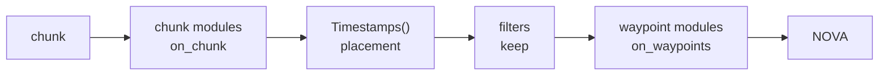

# The send pipeline

Every target that `PolicyExecutor`, `jog_joints` or `jog_tcp` sends to NOVA passes one ordered
list of modules, the send pipeline. The modules shape the targets before NOVA gets them: they
bridge a distant first step, ease in and out, clamp to joint limits, give a short chunk a
horizon to brake within, and drop waypoints that are already due.

Each motion group runs its own copy of the list, so two arms never share a module's state.

## How it works



| Kind | Sees | May change | Built-ins |
| --- | --- | --- | --- |
| chunk module | every chunk, when it is queued | steps and timing | `LiveBuffer`, `ServoHorizon`, `Smoothing`, `TimestepTimeline`, `Bridge`, `EndpointRamp`, `JointClamp`, `HoldPadding` |
| `Timestamps()` | the chunk | each step's time | the placement step, one per list |
| filter | the timed waypoints | which waypoints go out, never their time | `DropLate` |
| waypoint module | the timed waypoints, at every send | the values only | `EaseIn` |

The kinds run in this order. `Timestamps()` may be left out of the list; it then sits after the
last chunk module.

## The defaults

`pipeline=None` (the default) runs `default_pipeline(...)` for that use. An explicit list is
exactly what runs.

| Use | Default pipeline |
| --- | --- |
| `jog_joints`, `jog_tcp` | `HoldPadding` → `Timestamps` → `DropLate` |
| `PolicyExecutor` with `SequentialExecution` | `Bridge` → `EndpointRamp` → `JointClamp` → `HoldPadding(after_ms=300)` → `Timestamps` → `DropLate` |
| `PolicyExecutor` with `ContinuousExecution` | the policy's `default_modules` → `JointClamp` → `HoldPadding` → `Timestamps` → `DropLate` |

A policy's `default_modules` are empty, except for a `QueuedPolicyClient`: it adds
`Smoothing` → `TimestepTimeline` → `Bridge(always_anchor=True)`.

To see the list for your setup, call `default_pipeline` with the same arguments the executor gets:

```python
from novapolicy import ContinuousExecution, default_pipeline

default_pipeline()  # the joggers' list
default_pipeline(execution=ContinuousExecution(), policy=policy)  # the executor's list
```

## Add, remove or change a module

Start from the defaults and edit the list. Use the same `execution` and `policy` for
`default_pipeline` as for the executor.

```python
from novapolicy import (
    EaseIn,
    HoldPadding,
    LiveBuffer,
    PolicyExecutor,
    Timestamps,
    default_pipeline,
    jog_joints,
)

# Add a module
jog_joints(mg, pipeline=[LiveBuffer(window_ms=500), *default_pipeline()])
jog_joints(mg, pipeline=[*default_pipeline(), EaseIn(duration_s=1.0)])

# Remove a module
defaults = default_pipeline(execution=execution, policy=policy)
pipeline = [m for m in defaults if not isinstance(m, HoldPadding)]
PolicyExecutor(schema, policy, execution=execution, pipeline=pipeline)

# Change a module's settings
pipeline = [Timestamps(grid_ms=32) if isinstance(m, Timestamps) else m for m in defaults]
PolicyExecutor(schema, policy, execution=execution, pipeline=pipeline)
```

For teleoperation, put `ServoHorizon` in front of the joggers' defaults:

```python
from novapolicy import ServoHorizon, default_pipeline, jog_tcp

async with jog_tcp(mg, tcp="Flange", pipeline=[ServoHorizon(), *default_pipeline()]) as jogger:
    async for state in jogger:
        jogger.set_target(read_hand_pose())
```

## Built-in modules

All modules are importable from `novapolicy`, except `TimestepTimeline`, which is in
`novapolicy.pipeline`. Parameters show their defaults.

| Module | Kind | What it is for | Key parameters |
| --- | --- | --- | --- |
| `LiveBuffer` | chunk | Live targets from a dense source (`set_target`). Replays the last `window_ms` of targets as a horizon on an even grid, so the arm does not brake at every target. The arm trails the live target by about `window_ms`. | `window_ms=500` |
| `ServoHorizon` | chunk | Live targets from a hand, VR controller or other device that stops and reverses quickly (`set_target`). Follows the targets with a spring-damper and sends its path, braking onto the newest target, so the arm does not overshoot a sudden stop. Chunks of several steps pass through. | `gain=300` (1/s²), `lookahead_s=0.115`, `horizon_ms=400`, `step_ms=32`, `linear_acceleration=8000` (mm/s²), `linear_speed=1500` (mm/s), `angular_acceleration=40` (rad/s²), `angular_speed=3` (rad/s) |
| `Smoothing` | chunk | Smooths a chunk's steps with `passes` of a `[1, 2, 1] / 4` filter. Steps already sent keep their values; chunks under three steps pass unchanged. | `passes=2` |
| `TimestepTimeline` | chunk | Keeps a `QueuedPolicyClient`'s chunks on one timeline: a later chunk continues the plan instead of restarting at "now". Required for a queue in continuous execution. | none |
| `Bridge` | chunk | Bridges from the measured position to the policy's first step, at the chunk's own spacing, so a first step far from the robot is not a jump. Chunks with their own `first_timestamp_ms` pass unchanged. | `always_anchor=False`: `True` adds a hold on the measured position even when no bridge is needed |
| `EndpointRamp` | chunk | Eases into and out of each chunk by subdividing its first and last interval. For sequential execution, where every chunk starts and ends at rest. | `interpolation_steps=3` (at least 2) |
| `JointClamp` | chunk | Holds every joint target `margin_rad` inside the robot's joint limits, read when the session starts. TCP targets pass unchanged; a robot that reports no limits is sent unclamped, with a warning. | `margin_rad=0.035` (about 2°) |
| `HoldPadding` | chunk | Holds a chunk's last target until the chunk spans `min_horizon_ms`, and at least `after_ms` past its last step, so the controller has a horizon to brake within. Pads chunks only: not live targets (`set_target`), and not one-step policy actions in continuous execution. | `min_horizon_ms=500`, `after_ms=0` |
| `Timestamps` | placement | Gives each step its time on NOVA's clock. `grid_ms` puts one-step joint targets on multiples of `grid_ms`, resampled from the policy's path. Use a multiple of NOVA's 8 ms cycle, such as 32 for a 30 Hz policy, if a one-step policy's motion pulses. Multi-step chunks and TCP targets keep their times. | `grid_ms=None` (off) |
| `DropLate` | filter | Drops waypoints due within `min_lead_ms` of now; the others keep their times. When all are late, nothing is sent and the arm keeps following the previous chunk. | `min_lead_ms=20` |
| `EaseIn` | waypoint | Blends each waypoint from where the robot stood to its value over the first `duration_s`, by the waypoint's own timestamp. For time-based targets that start with velocity, such as a sine, which would otherwise lunge from rest. | `duration_s` (required) |

`HoldPadding` and `WaypointConfig.delay_until_braking_ms` are two ways to give a chunk a braking
horizon. To use `delay_until_braking_ms`, remove `HoldPadding` from the list.

Invalid parameters raise `ValueError` when the module is created: a non-positive `window_ms`,
`duration_s` or `grid_ms`, negative `passes`, `interpolation_steps` below 2, a negative
`min_horizon_ms` or `after_ms`, or a non-positive `ServoHorizon` setting. `ServoHorizon` also needs
`step_ms` of at least 2 and `horizon_ms` of at least `step_ms`.

## Order and valid combinations

Chunk modules run in a fixed order:

`LiveBuffer` or `ServoHorizon` → `Smoothing` → `TimestepTimeline` → `Bridge` → `EndpointRamp` →
`HoldPadding`

`JointClamp` and your own modules may stand anywhere among them. Put `JointClamp` after
`ServoHorizon`: the spring can pass its target. Use `LiveBuffer` or `ServoHorizon`, not both.

The list is checked when the executor or jogger is created. These raise `ValueError`:

- A chunk module after `Timestamps()`, a filter or a waypoint module.
- A filter after a waypoint module.
- `Timestamps()` twice, or after a filter or waypoint module.
- Chunk modules out of the order above.
- A built-in module twice.

An item that has none of `on_chunk`, `keep` or `on_waypoints` raises `TypeError`.

`PolicyExecutor` also raises `ValueError` for:

- A `QueuedPolicyClient` in `ContinuousExecution` without `TimestepTimeline` in the list.
- A `QueuedPolicyClient` in `SequentialExecution`.
- `LiveBuffer` in `SequentialExecution`.

It logs a warning, and runs as asked, for:

- The joggers' default list (`default_pipeline()` without arguments): it has no `Bridge` and no
  `JointClamp`.
- `EndpointRamp` in `ContinuousExecution`: the arm stops at every replacement.

## Write your own module

A module is any object with one of three methods. Which method it has decides its kind. Import
the protocols and `ModuleContext` from `novapolicy.pipeline`.

| Kind | Method | Returns |
| --- | --- | --- |
| `ChunkModule` | `on_chunk(chunk, context)` | the chunk to pass on |
| `WaypointFilter` | `keep(waypoints, chunk, context)` | some of `waypoints`, in order, unchanged |
| `WaypointModule` | `on_waypoints(waypoints, context)` | one list of values per waypoint, in order |

`chunk` is a frozen dataclass: `chunk.steps` holds the steps (joint positions, or TCP poses as
`[x, y, z, rx, ry, rz]` in mm and rad) and `chunk.dt_ms` their spacing. Return a changed copy
with `dataclasses.replace`. `waypoints` is a list of `(time_ms, values)` pairs.

`context` is a `ModuleContext` with what a module may read besides its input:

| Field | Meaning |
| --- | --- |
| `now_ms` | the session clock now |
| `position` | the robot's latest measured position, in the waypoints' form; `None` before one |
| `step_ms` | the session's spacing for steps without their own (`WaypointConfig.single_step_dt_ms`) |
| `motion_group_id` | the motion group the session drives |
| `mode` | `"joint"` or `"cartesian"` (TCP poses) |
| `joint_limits` | the robot's joint limits when a `JointClamp` is in the list, else `None` |

A chunk module that keeps the last joint where the robot is:

```python
from dataclasses import dataclass, replace

from novapolicy.pipeline import ModuleContext


@dataclass
class HoldLastJoint:
    def on_chunk(self, chunk, context: ModuleContext):
        if context.mode != "joint" or context.position is None:
            return chunk
        last = context.position[-1]
        return replace(chunk, steps=[[*step[:-1], last] for step in chunk.steps])
```

A waypoint module that raises every TCP waypoint by a fixed offset:

```python
from dataclasses import dataclass

from novapolicy.pipeline import ModuleContext


@dataclass
class RaiseTcp:
    offset_mm: float

    def on_waypoints(self, waypoints, context: ModuleContext) -> list[list[float]]:
        if context.mode != "cartesian":
            return [list(values) for _, values in waypoints]
        return [[x, y, z + self.offset_mm, *rest] for _, (x, y, z, *rest) in waypoints]
```

Add them like a built-in module:

```python
jog_joints(mg, pipeline=[HoldLastJoint(), *default_pipeline()])
jog_tcp(mg, tcp="Flange", pipeline=[*default_pipeline(), RaiseTcp(offset_mm=10.0)])
```

Rules for your own modules:

- A waypoint module sees a waypoint again each time it is re-sent, with its original value. Give
  the same timestamp the same result, so a re-sent waypoint does not change.
- A filter may drop waypoints but must not change their times or values.
- Do not give your module a `stage` attribute; the built-in modules use it for their order.
- Each motion group gets its own copy of the module, so keeping state on `self` is safe.
